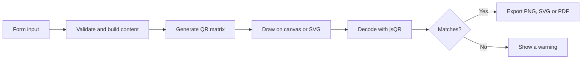

<p align="center">
  <a href="https://github.com/Devputta/QRForge">
    
  </a>
</p>

<h1 align="center">QRForge</h1>

<p align="center">
  <strong>A private, browser-only QR code generator.</strong><br />
  Make codes for links, Wi-Fi, contacts, maps and more. Check that they scan, then export for screen or print.
</p>

<p align="center">
  <a href="https://github.com/Devputta/QRForge/actions/workflows/ci.yml">
    
  </a>
  
  
  
  
  
  
</p>

<p align="center">
  <a href="#quick-start">Quick start</a> ·
  <a href="#features">Features</a> ·
  <a href="#supported-qr-types">QR types</a> ·
  <a href="#privacy-and-security">Privacy</a> ·
  <a href="#contributing">Contributing</a>
</p>

---

## Table of contents

- [Why QRForge](#why-qrforge)
- [Features](#features)
- [Supported QR types](#supported-qr-types)
- [Quick start](#quick-start)
- [How it works](#how-it-works)
- [Static codes: what that means](#static-codes-what-that-means)
- [Privacy and security](#privacy-and-security)
- [Accessibility](#accessibility)
- [Tech stack](#tech-stack)
- [Project structure](#project-structure)
- [Scripts](#scripts)
- [Testing](#testing)
- [Deployment](#deployment)
- [Known limitations](#known-limitations)
- [Roadmap](#roadmap)
- [Contributing](#contributing)
- [Security reporting](#security-reporting)
- [License](#license)
- [Disclaimer](#disclaimer)

---

## Why QRForge

Many online QR generators send every scan through their own redirect server, add ads to the landing page, or turn the code off unless you pay. Others upload your Wi-Fi password or contact details to a database you never agreed to.

QRForge takes a simpler approach:

- **Direct encoding.** The code contains your actual destination. Scanners go straight there, with no middleman.
- **Everything stays local.** Codes are generated in your browser. There is no backend, no account, no API key and no telemetry.
- **Nothing to expire.** There is no subscription to lapse and no server that can be switched off.
- **Checked before you print.** Each code is decoded again in the browser so you know a camera can read it.

## Features

**Create**
- 11 content types, from websites and Wi-Fi to calendar events (see the [table below](#supported-qr-types)).
- Optional UTM fields for website links.
- Batch mode: upload a CSV and get a ZIP of finished codes with a manifest.

**Style**
- Square, rounded or dot-shaped data modules.
- Square, rounded or circular corner markers.
- Custom colors with a live WCAG contrast check.
- Error correction levels L, M, Q and H.
- Adjustable quiet zone (0, 1, 2 or 4 modules).
- Center logo from a built-in preset or your own upload, with a warning if the error correction is too low.

**Verify**
- **Scan check:** the rendered code is decoded with jsQR and compared with what you meant to encode.
- Contrast ratio and QR version shown next to the preview.

**Export**
- PNG at 512, 1024 or 2048 px.
- SVG for signage and design tools.
- PDF at a physical size you choose in centimeters.
- Copy to clipboard and print preview.

**Keep**
- Local library with search, filters, duplicate and delete.
- JSON backup and restore, with validation on import.
- Drafts survive a refresh.
- Light and dark themes that follow your system, plus a manual toggle.

## Supported QR types

| Type | What is encoded | Notes |
| --- | --- | --- |
| Website | `https://...` | Only http and https. Optional UTM builder. |
| Google Maps | Search, directions or a pasted Maps link | Driving, walking, cycling and transit modes. |
| Wi-Fi | `WIFI:S:<ssid>;T:<type>;P:<pass>;;` | WPA, WEP or open. Passwords are never saved. |
| Contact card | vCard 3.0 | Commas, semicolons, backslashes and newlines are escaped. |
| WhatsApp | `https://wa.me/<number>?text=...` | Optional prefilled message. |
| Plain text | The text itself | Notes, serial numbers, access codes. |
| Calendar event | iCalendar 2.0 | Timed or all-day events. |
| Social profile | Profile URL | LinkedIn, X, GitHub, Instagram, YouTube or any custom URL. |
| Email | `mailto:` with subject and body | RFC 6068 encoding. |
| Phone and SMS | `tel:` or `smsto:` | Optional pre-written message. |
| File link | HTTPS share link | Reminder to check sharing permissions. |

## Quick start

**Requirements:** Node.js 20 or newer and npm.

```bash
git clone https://github.com/Devputta/QRForge.git
cd QRForge
npm install
npm run dev
```

Open <http://localhost:3000>.

## How it works



Each content type has its own builder in `src/utils/qrPayloads.ts`. The renderer in `src/utils/qrRenderer.ts` draws the same matrix to a canvas for PNG and to markup for SVG, so what you see is what you export.

## Static codes: what that means

Every code made with QRForge is static.

| You get | You do not get |
| --- | --- |
| Codes that work as long as the destination stays online | Edit-after-printing |
| Direct scans with no redirect | Scan counts or analytics |
| No account, expiry or fees | A dashboard |

Double-check URLs, passwords and phone numbers before you print anything.

## Privacy and security

- **No network calls for your data.** Content never leaves the browser tab.
- **No trackers.** No analytics scripts, cookies or third-party requests. Fonts are self-hosted.
- **Wi-Fi passwords are never stored.** They are stripped from drafts and from JSON backups.
- **Safe printing.** The print preview is built with DOM text nodes, not HTML strings, so content cannot inject markup.
- **Validated imports.** Library JSON and CSV files are checked before use.
- **Protocol allow-list.** Website and file links accept only http and https.

Your library and drafts live in your browser's `localStorage` or `sessionStorage`. Clearing site data removes them, so use the JSON export if you want a backup.

Found a vulnerability? See [Security reporting](#security-reporting).

## Accessibility

- Modals trap focus, close with `Esc`, and return focus to the button that opened them.
- Icon-only buttons have text labels for screen readers.
- Touch targets are at least 44 px on mobile.
- Layouts are tested from 320 px to 1440 px wide.
- Errors appear inline next to the field, not in blocking alerts.

## Tech stack

| Area | Tools |
| --- | --- |
| UI | React 19, TypeScript, Tailwind CSS 4 |
| Build | Vite 8 |
| QR generation | `qrcode` |
| QR verification | `jsqr` |
| PDF export | `jspdf` |
| Batch ZIP | `jszip` |
| Icons | `lucide-react` |
| Fonts | `@fontsource/plus-jakarta-sans`, `@fontsource/jetbrains-mono` (self-hosted) |
| Tests | Vitest 5, Happy DOM |

## Project structure

```text
QRForge/
├── .github/workflows/ci.yml     # Lint, test and build on every push
├── docs/                        # PRD, architecture, security, testing, roadmap and more
├── src/
│   ├── components/
│   │   ├── DestinationForms/    # One form per QR type
│   │   ├── BatchGenerator.tsx
│   │   ├── Header.tsx
│   │   ├── QRPreviewPanel.tsx
│   │   ├── SavedLibrary.tsx
│   │   ├── StandardsModal.tsx
│   │   └── StyleControls.tsx
│   ├── types/qr.ts              # Shared types
│   ├── utils/
│   │   ├── batchProcessor.ts    # CSV parsing and ZIP creation
│   │   ├── contrast.ts          # WCAG contrast math
│   │   ├── presetLogos.ts
│   │   ├── qrPayloads.ts        # Content builders and validators
│   │   ├── qrRenderer.ts        # Canvas and SVG drawing
│   │   ├── theme.ts
│   │   └── useModalA11y.ts
│   ├── App.tsx
│   ├── index.css
│   └── main.tsx
├── tests/                       # Vitest suites
├── QR/                          # QR image used in this README
├── CONTRIBUTING.md
├── SECURITY.md
├── CODE_OF_CONDUCT.md
└── LICENSE
```

## Scripts

| Command | What it does |
| --- | --- |
| `npm run dev` | Start the dev server on port 3000 |
| `npm run build` | Create a production build in `dist/` |
| `npm run preview` | Serve the production build locally |
| `npm run lint` | Type-check with TypeScript |
| `npm test` | Run the test suite once |

## Testing

```bash
npm test
```

The suite covers:

- Every content builder, including escaping rules and decode-back checks with jsQR.
- Renderer output, SVG shapes, preset logos and contrast math.
- Security fixes: safe print output, Wi-Fi password stripping and CSV rules.
- Modal focus trapping and theme switching.
- Form components, the batch tool and the library.
- End-to-end create, save and restore flows.
- Layout limits from 320 px to 1440 px.

See [`docs/TESTING.md`](docs/TESTING.md) for the strategy and the manual QA matrix in [`docs/TEST-CASES.md`](docs/TEST-CASES.md).

## Deployment

QRForge builds to plain static files, so any static host works (GitHub Pages, Netlify, Vercel, Cloudflare Pages, S3).

```bash
npm run build
```

Upload the `dist/` folder. If you host under a sub-path such as GitHub Pages at `/QRForge/`, set `base: '/QRForge/'` in `vite.config.ts`. More detail is in [`docs/DEPLOYMENT.md`](docs/DEPLOYMENT.md).

## Known limitations

- **Printed codes cannot be changed.** The destination is baked into the pattern.
- **Long content makes dense codes.** Above roughly 300 characters the modules get small. Use a higher error correction level and print larger.
- **Logos cover data.** Use level H when a logo is present.
- **The scan check is a good sign, not a guarantee.** Always test a printed code with a real phone before a big print run.

## Roadmap

Completed and planned work is tracked in [`docs/ROADMAP.md`](docs/ROADMAP.md). Ideas and requests are welcome in [Issues](https://github.com/Devputta/QRForge/issues).

## Contributing

Contributions are welcome, from bug reports to new QR types.

1. Fork the repository and create a branch.
2. Make a focused change that follows the existing style.
3. Run `npm run lint` and `npm test`.
4. Open a pull request that explains what changed and why.

Please read [`CONTRIBUTING.md`](CONTRIBUTING.md) and the [Code of Conduct](CODE_OF_CONDUCT.md) first. Never commit real passwords, private documents or API keys.

## Security reporting

Please do not post vulnerability details in a public issue. Follow the steps in [`SECURITY.md`](SECURITY.md) to report privately.

## License

Released under the [MIT License](LICENSE).

## Disclaimer

QRForge is provided for general-purpose QR code generation. You are responsible for checking what each code contains and for having the rights to any logos or content you add.

A QR code can point to a harmful or misleading destination. Check a destination before sharing a code or opening one.

The software is provided "as is", without warranty of any kind, to the extent permitted by law. The maintainers are not responsible for misuse of generated codes, third-party destinations or resulting losses. This project is not affiliated with or endorsed by any third-party brand or service.


<p align="center">  <a href="https://github.com/Devputta/Drafts-might-be-needed-/blob/main/LOGO/Gemini_Generated_Image_1ppnm1ppnm1ppnm1%20(1).jfif" target="_blank" rel="noopener noreferrer">      </a></p>


---


<p align="center">
  <strong>QRForge</strong><br />
  Private by design. Static by choice.
</p>
